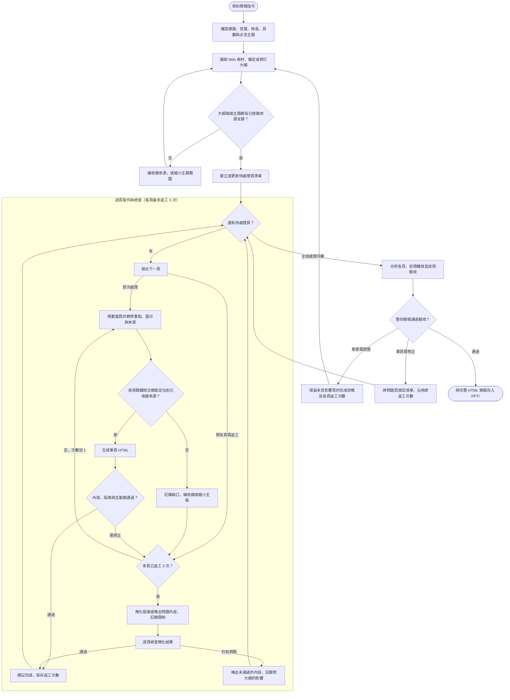

# GenAI LLM Wiki

## 目標與範圍

- 先支援《Gen AI 是什麼？》HTML 教學簡報備課，長期累積可重用的生成式 AI 教材。
- 依使用者提供的論文決定主題與深度。新來源涉及既有概念時，優先補充既有頁面。需要獨立說明時再新增頁面。
- 使用台灣繁體中文撰寫，專有名詞首次出現時可附英文。以 Obsidian 瀏覽 Markdown，站內連結使用 `[[檔名|顯示名稱]]`。

## 目錄與檔案

| 路徑                | 用途                        |
| ----------------- | ------------------------- |
| `README.md`       | Obsidian 入口與操作方式          |
| `raw/pdfs/`       | 原始 PDF。保留原始檔案內容，可為歸檔調整檔名  |
| `wiki/index.md`   | 依類別列出頁面連結與一句話摘要           |
| `wiki/log.md`     | 依時間追加收錄、寫回與整體檢查的變更紀錄      |
| `wiki/sources/`   | 每份論文對應的來源筆記               |
| `wiki/concepts/`  | 跨來源整理的概念條目                |
| `wiki/syntheses/` | 可重用的教學整理，例如比較、圖解說明、案例與測驗  |
| `templates/`      | 供概念條目與來源筆記使用的 Markdown 範本 |
| `PPT/`            | 存放本專案完成的 HTML 教學簡報          |

頁面檔名在整個 Wiki 中保持唯一，方便 Obsidian 解析連結。來源可用 `source-作者-年份-簡稱.md`，概念與教學整理可用 `concept-主題.md`、`synthesis-主題.md`。已有頁面沿用原檔名，改名時同步修正連結。

## 收錄 PDF 或 arXiv

1. 使用者在本專案上傳 PDF 即開始收錄。貼上 arXiv 摘要頁、PDF 網址或可辨識的 arXiv 識別碼時，從 arXiv 下載對應 PDF；指定版本時保留該版本。
2. 先查 `wiki/index.md` 和既有來源筆記，以 arXiv ID、DOI 或標題與作者比對。同一版本重複提交時沿用既有筆記。不同版本另外保留 PDF，並在同一來源筆記標明用來支持說法的版本。
3. 將原始 PDF 存入 `raw/pdfs/`，保留檔案內容。能讀到正文後，依 `templates/source.md` 建立或更新來源筆記，記下標題、作者、年份、可取得的論文識別資訊與原始 PDF 連結。無法下載或讀取時回報具體原因，將來源視為待補。
4. 擷取與 GenAI 教材有關的定義、原理、結果及限制，更新相關概念與教學整理。重要說法連回來源筆記，能確認時註明 PDF 頁碼、章節、圖或表。來源互有差異時，保留各自的說法、依據與適用條件。
5. 檢查這次新增或修改的連結，更新 `wiki/index.md`，並在 `wiki/log.md` 末尾追加一筆日期、操作與變更頁面。回報收錄了什麼，以及仍有哪些資料缺口。

## 概念條目

依 `templates/concept.md` 撰寫。每頁包含**一句話定義、運作流程、例子、常見誤解、相關條目、來源**。有足夠來源可解釋時補上「進階原理」。例子若是為教學設計，標為「教學示例」。來源不足時在對應段落標明缺口，待有資料再補。

## 問答與寫回

- 從 `wiki/index.md` 找相關條目，再依需要追到來源筆記與原始 PDF。回答時指出所依據的條目或來源。
- Wiki 的資料不足時，先說明缺少什麼，以及目前能回答到哪裡。使用者另有要求時，再進行外部查找。
- 問答產出可重用且有來源依據的內容時，自動合併進既有條目，或新增教學整理。同步更新相關連結、索引與紀錄，並告知使用者寫回了哪些頁面。

## 整體檢查與簡報

- 使用者下指令時才做整體檢查。檢查連結、索引遺漏、孤立頁面、引用、過時內容、矛盾與資料缺口。能確認的問題修正後寫入紀錄。仍待查證的內容列為待補。
- 收錄和條目整理應讓教材日後能追溯至原始來源。等使用者啟動簡報製作時，再根據 Wiki 與當時確認的教學需求規劃內容及 HTML 格式。

## HTML 簡報製作 Graph 與逐頁 Loop

收到簡報指令後，先整理教學需求，再依 Wiki 已收錄的來源擬定大綱。使用者指定的主題、篇幅、稿件或樣式優先。未指定的項目採合理假設並記入大綱，助理可繼續製作，交付時說明假設。大綱與各頁分別通過來源檢查後，再合併驗收。

### 來源引用規則

- 每頁的「論文依據」只列已收錄來源。每篇須同時具備 `wiki/sources/` 的來源筆記與 `raw/pdfs/` 中對應版本、可開啟的 PDF。逐項核對關鍵說法，在該頁註明支持說法的 PDF 頁碼、章節、圖號或表號。外部連結可供讀者開啟原文，不能單獨作為收錄憑據。
- 只透過他篇引文得知的研究，標示「經〈某來源〉引述」，並指出**已收錄的引述來源**在哪裡談到這項說法。只轉述該處實際說明的內容，不標註被引論文自己的頁碼、章節或圖表。僅出現在參考文獻表的題名，不能支撐對其方法或結果的說明。
- 若未收錄論文是某頁的核心依據，先依「收錄 PDF 或 arXiv」流程補齊來源，再核對正文。無法補齊時，記錄缺口，縮小主張或移除該內容，重新檢查後才進入製作。

### 製作流程

### 各階段的檢查與回修

| 階段 | 檢查與處理方式 |
| --- | --- |
| 確認需求 | 在大綱前列出標題、受眾、教學時長、頁數與必含主題。使用者未指定時，依 Wiki 目前可支持的範圍設定並記錄假設。標題須準確反映涵蓋的年代、任務與深度。 |
| 擬定大綱 | 從 `wiki/index.md` 找到相關條目及來源筆記，列出每頁標題、教學重點與已收錄來源。大綱預設含「定義」「限制與風險」「總結」，使用者明確排除時依其要求調整。時間線依原論文的年份與任務歸類，比較頁排在相關模型介紹之後。每個主題都有已收錄來源支撐，才建立清單。 |
| 建立待處理頁清單 | 首次製作時列入所有頁面。逐頁保存狀態與返工次數。修訂大綱時保留未受影響頁的完成狀態與各頁已有的返工次數，僅將新增或受影響的頁面列入清單，並依新大綱調整頁序。 |
| 規劃與查證當頁 | 確認當頁要回答的問題、圖示及關鍵說法，依「來源引用規則」查核對應版本與引文位置。發現缺口時先記錄，再補收錄、縮小主張或移除問題內容。返工後重新查證。 |
| 生成與檢查單頁 | 開啟 HTML，對照原文查核說法與引用，檢視文字與圖示是否清楚、有無裁切，並實際操作互動功能。通過後才標記該頁完成。 |
| 計算返工與回報 | 新頁從 0 次開始，每次重新規劃前加 1。逐頁檢查與整份驗收共用同一計數。第 3 次返工後仍有問題，採用可驗證的簡化版面或略去問題內容，再逐頁複查來源、顯示與互動。略去仍未通過的內容，記錄影響，交付時說明。 |
| 合併與整份驗收 | 從頭播放，核對大綱、頁序、翻頁與顯示，並逐一完成下列六項驗收。單頁問題退回該頁。章節問題退回大綱，沿用清單狀態及返工次數，修正後再驗收。通過後將完整 HTML 存入專案根目錄的 `PPT/`，目錄尚未存在時先建立，並交付檔案連結。 |

### 整份簡報驗收項目

1. **標題與範圍。** 核對標題、涵蓋年代、實際內容與確認的必含主題。若只選讀特定論文，應讓讀者從標題或副標題看出選讀範圍。
2. **逐頁引用。** 從每頁的「論文依據」找到來源筆記、同版本的本機 PDF，以及支持說法的具體位置。間接引述須能回查到引述者的原文。
3. **比較順序。** 每個列入比較的模型都已在前面的頁面介紹過，讀者可以辨認它的任務、輸入與輸出。
4. **數據解讀。** 含研究數據的頁面須說明指標與評估條件，並給出可比較的基準或適用限制。
5. **測驗涵蓋。** 若有小測驗，逐章對照題目，確認各主要章節都有對應題目。實際測試答對與答錯的回饋，答錯時可看到正解與理由。
6. **分享連結。** 把 HTML 單獨移到專案外測試。確認分享版可獨立顯示與操作。若保留專案內的相對連結，在連結旁明確標示「僅限專案內開啟」。
